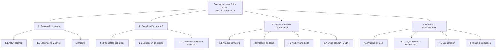
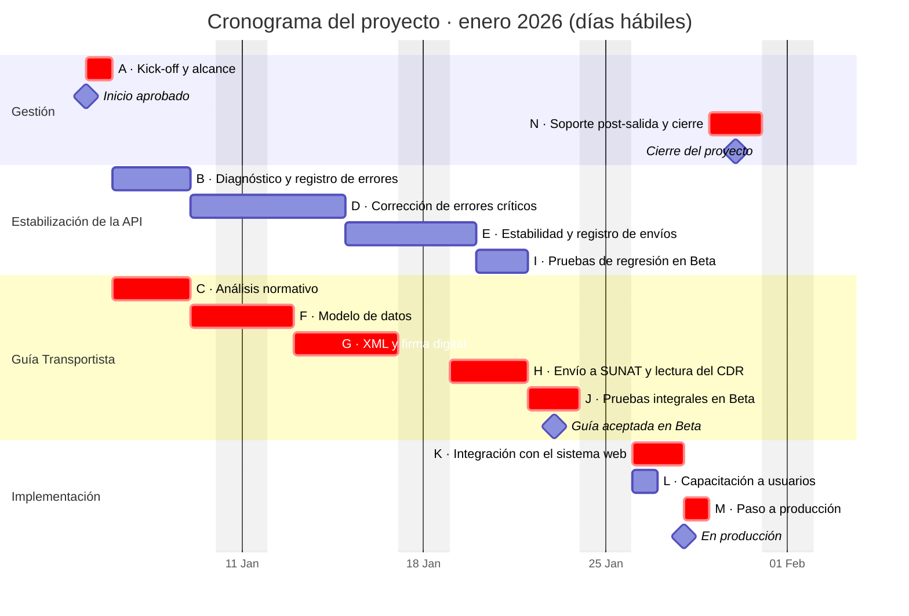
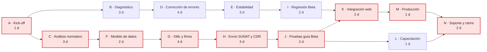
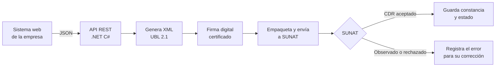

# Facturación electrónica SUNAT: mejora de API e incorporación de la Guía de Remisión Transportista

> **Proyecto · Dirección de Proyectos de TI**
> Evolución de una API REST de facturación electrónica de código abierto: corrección de errores, mejoras de estabilidad y un nuevo comprobante, la **Guía de Remisión Electrónica Transportista**.

<!--
  CÓMO USAR ESTE ARCHIVO
  Los comentarios como este NO se ven en GitHub. Sirven de guía para completar el caso.
  Reemplaza o amplía los textos donde veas "COMPLETAR". Si no tienes una cifra exacta, no la inventes:
  usa un rango aproximado o describe el resultado en palabras.
-->

---

## 📋 Resumen

| | |
|---|---|
| **Rol** | Líder de proyecto y desarrollador |
| **Periodo** | 5 al 30 de enero de 2026 (4 semanas, 20 días hábiles) |
| **Metodología** | SCRUM, con cronograma y ruta crítica para el control del plazo |
| **Tecnologías** | .NET C#, ASP.NET Web API, XML UBL 2.1, firma digital, servicios web de SUNAT |
| **Punto de partida** | [OpenInvoicePeru](https://github.com/erickorlando/openinvoiceperu), API de código abierto (licencia Apache 2.0) |
| **Entregable principal** | API estabilizada y nuevo módulo de Guía de Remisión Transportista |

<!-- COMPLETAR: si quieres, agrega una fila "Equipo" (por ejemplo: "2 desarrolladores + 1 analista") -->

---

## 🎯 Contexto y problema

La empresa necesitaba emitir comprobantes electrónicos válidos ante SUNAT desde su sistema web, incluyendo la guía que acompaña el traslado de mercadería cuando el transporte lo realiza un tercero.

Se tomó como base **OpenInvoicePeru**, una API REST en C# que genera, firma y envía a SUNAT facturas, boletas, notas de crédito y débito, resúmenes diarios, comunicaciones de baja, retenciones, percepciones y guías de remisión. El proyecto había sido archivado por su autor en 2024, por lo que ya no recibía correcciones.

Esto planteaba tres problemas:

1. **Errores sin resolver** en la generación y el envío de comprobantes.
2. **Falta de la Guía de Remisión Transportista**, necesaria para la operación logística.
3. **Ausencia de mantenimiento**: cualquier cambio de SUNAT tenía que resolverse internamente.

<!-- COMPLETAR: ¿qué impacto tenían esos problemas? Ejemplos: "comprobantes rechazados que se reenviaban a mano",
     "guías emitidas fuera del sistema", "horas de soporte por semana". -->

---

## 🧭 Objetivo

Contar con una API de facturación electrónica **estable, mantenible y completa** para la operación, que emita también la **Guía de Remisión Electrónica Transportista** y se integre con el sistema web de la empresa.

**Criterios de éxito:**
- Comprobantes aceptados por SUNAT en el entorno de pruebas (Beta) y en producción.
- Guía Transportista emitida desde el sistema, con su constancia de recepción (CDR).
- Corrección de los errores identificados sin afectar los comprobantes que ya funcionaban.

---

## 📦 Alcance

| Incluido | Fuera de alcance |
|---|---|
| Diagnóstico y corrección de errores de la API | Cambios en el sistema contable |
| Mejoras de estabilidad y manejo de respuestas de SUNAT | Nuevos tipos de comprobante distintos a la guía |
| Nuevo módulo: Guía de Remisión Transportista | Rediseño de la interfaz de usuario |
| Pruebas en entorno Beta de SUNAT y paso a producción | |
| Documentación técnica y capacitación a usuarios | |

---

## 👤 Mi rol

- **Planificación:** definí el alcance, la EDT, el cronograma con ruta crítica, la matriz RACI y el backlog.
- **Seguimiento y control:** dirigí los sprints, reporté el avance al sponsor y gestioné los riesgos.
- **Análisis:** revisé la normativa y los formatos de SUNAT para la Guía Transportista.
- **Desarrollo:** implementé las correcciones y el nuevo módulo en .NET C#.
- **Calidad:** diseñé y ejecuté las pruebas en el entorno Beta de SUNAT.
- **Puesta en producción:** coordiné el despliegue, la capacitación y el soporte inicial.

---

## 🗂️ Dirección del proyecto

El proyecto se planificó para **4 semanas (20 días hábiles), del 5 al 30 de enero de 2026**, y se ejecutó con **SCRUM** en sprints semanales. Para el control del plazo se usó un cronograma con **ruta crítica**, que mostraba qué actividades no podían retrasarse sin mover la fecha de entrega.

<!-- COMPLETAR: las duraciones y fechas de abajo son una propuesta coherente con un proyecto de enero 2026.
     Ajústalas a lo que realmente ocurrió. Si cambias una duración, avísame y recalculo la ruta crítica
     para que el Gantt, la red y la tabla sigan cuadrando. -->

### 1. Interesados

| Interesado | Interés en el proyecto | Influencia | Estrategia |
|---|---|---|---|
| Gerencia (sponsor) | Cumplir con SUNAT sin detener la operación | Alta | Reporte semanal de avance y riesgos |
| Usuarios de Facturación | Emitir comprobantes sin rechazos | Media | Participación en las revisiones de sprint |
| Operaciones y Transporte | Emitir la Guía Transportista desde el sistema | Media | Validación de la guía en Beta y capacitación |
| Contabilidad | Integridad de la información de comprobantes | Media | Consulta en reglas de negocio |
| TI e Infraestructura | Despliegue seguro y estable | Media | Coordinación del paso a producción |
| SUNAT (regulador) | Cumplimiento del formato y la normativa | Alta | Validación en el entorno Beta |

### 2. Estructura de desglose del trabajo (EDT)

### 3. Cronograma (diagrama de Gantt)

Las barras en rojo forman la **ruta crítica**.

### 4. Red de actividades y ruta crítica

**Ruta crítica: A → C → F → G → H → J → K → M → N = 20 días hábiles.**

El frente de estabilización de la API (B, D, E, I) tenía **2 días de holgura**. Por eso la Guía Transportista se priorizó desde el primer sprint: cualquier retraso en ella movía directamente la fecha de entrega.

| Act. | Actividad | Dur. (d) | Predecesoras | IT | FT | IL | FL | Holgura |
|:---:|---|:---:|:---:|:---:|:---:|:---:|:---:|:---:|
| **A** | **Kick-off y definición de alcance** | 1 | — | 0 | 1 | 0 | 1 | **0** |
| B | Diagnóstico del código y registro de errores | 3 | A | 1 | 4 | 3 | 6 | 2 |
| **C** | **Análisis normativo de la Guía Transportista** | 3 | A | 1 | 4 | 1 | 4 | **0** |
| D | Corrección de errores críticos | 4 | B | 4 | 8 | 6 | 10 | 2 |
| E | Mejoras de estabilidad y registro de envíos | 3 | D | 8 | 11 | 10 | 13 | 2 |
| **F** | **Diseño del modelo de datos de la guía** | 2 | C | 4 | 6 | 4 | 6 | **0** |
| **G** | **Desarrollo: XML y firma de la guía** | 4 | F | 6 | 10 | 6 | 10 | **0** |
| **H** | **Envío a SUNAT y lectura del CDR** | 3 | G | 10 | 13 | 10 | 13 | **0** |
| I | Pruebas de regresión en Beta | 2 | E | 11 | 13 | 13 | 15 | 2 |
| **J** | **Pruebas integrales de la guía en Beta** | 2 | H | 13 | 15 | 13 | 15 | **0** |
| **K** | **Integración con el sistema web** | 2 | I, J | 15 | 17 | 15 | 17 | **0** |
| L | Capacitación a usuarios | 1 | J | 15 | 16 | 17 | 18 | 2 |
| **M** | **Paso a producción** | 1 | K | 17 | 18 | 17 | 18 | **0** |
| **N** | **Soporte post-salida y cierre** | 2 | L, M | 18 | 20 | 18 | 20 | **0** |

IT/FT: inicio y fin más tempranos · IL/FL: inicio y fin más tardíos · en días hábiles desde el inicio del proyecto. En negrita, las actividades críticas.

### 5. Hitos

| Hito | Fecha | Criterio de cumplimiento |
|---|---|---|
| Inicio aprobado | 05 ene | Alcance validado por el sponsor |
| Backlog priorizado | 08 ene | Errores registrados y ordenados por impacto |
| API estabilizada en Beta | 21 ene | Pruebas de regresión aprobadas |
| Guía aceptada en Beta | 23 ene | CDR de aceptación de SUNAT en el entorno de pruebas |
| En producción | 28 ene | Primera guía emitida desde el sistema |
| Cierre | 30 ene | Informe de cierre y lecciones aprendidas |

### 6. Matriz RACI

**R** = Responsable · **A** = Aprueba · **C** = Consultado · **I** = Informado

| Entregable | Líder de proyecto (yo) | Desarrollo | QA | Usuarios clave | Sponsor | TI / Infra |
|---|:---:|:---:|:---:|:---:|:---:|:---:|
| Acta y alcance | R | I | I | C | **A** | I |
| Diagnóstico y corrección de errores | **A** | R | C | I | | |
| Análisis normativo de la guía | **A** / R | C | C | C | | |
| Diseño y desarrollo de la guía | **A** | R | C | C | | |
| Pruebas en Beta | **A** | C | R | C | | |
| Integración con el sistema web | **A** | R | C | | | C |
| Capacitación a usuarios | **A** / R | | | I | | |
| Paso a producción | **A** | C | C | I | I | R |
| Informe de cierre | R | I | I | I | **A** | I |

<!-- COMPLETAR: ajusta los roles al equipo real. Si tú cubriste desarrollo y QA, puedes unir columnas
     ("Líder de proyecto / Desarrollo") y dejarlo explícito: también es un dato valioso. -->

### 7. Sprints

| Sprint | Fechas | Objetivo | Actividades |
|---|---|---|---|
| 1 | 05 – 09 ene | Alcance y diagnóstico | A, B, C · inicio de D y F |
| 2 | 12 – 16 ene | Errores críticos y desarrollo de la guía | D, F, G |
| 3 | 19 – 23 ene | Estabilidad, envío a SUNAT y pruebas en Beta | E, H, I, J |
| 4 | 26 – 30 ene | Integración, producción y cierre | K, L, M, N |

### 8. Plan de comunicaciones

| Reunión o reporte | Frecuencia | Participantes | Objetivo |
|---|---|---|---|
| Daily | Diaria (15 min) | Equipo del proyecto | Avance, bloqueos y siguiente paso |
| Planificación de sprint | Lunes | Equipo y usuarios clave | Definir el alcance del sprint |
| Revisión de sprint | Viernes | Equipo y usuarios clave | Validar lo construido |
| Reporte de estado | Semanal | Sponsor | Avance frente a la ruta crítica, riesgos y decisiones |
| Informe de cierre | Al final | Sponsor e interesados | Resultados y lecciones aprendidas |

### 9. Gestión de riesgos

| ID | Riesgo | Prob. | Impacto | Respuesta | Acción |
|:---:|---|:---:|:---:|:---:|---|
| R1 | Retraso en la Guía Transportista, que está en la ruta crítica | Media | Alto | Mitigar | Priorizarla desde el sprint 1 y seguirla a diario |
| R2 | Cambios normativos de SUNAT durante el proyecto | Media | Alto | Mitigar | Validar contra la documentación oficial y probar en Beta |
| R3 | Afectar los comprobantes que ya funcionaban | Media | Alto | Mitigar | Pruebas de regresión antes del paso a producción |
| R4 | Proyecto base archivado y sin soporte del autor | Alta | Medio | Aceptar | Revisión completa del código y documentación interna |
| R5 | Poca disponibilidad de usuarios para validar | Media | Medio | Mitigar | Revisiones de sprint agendadas desde el inicio |
| R6 | Certificado digital vencido o mal configurado | Baja | Alto | Evitar | Verificar vigencia y configuración antes de producción |

---

## 🏗️ Solución técnica

### Mejoras y correcciones

- Corrección de errores en la generación y el envío de comprobantes.
- Mejoras de estabilidad en el procesamiento de las respuestas de SUNAT.

<!-- COMPLETAR con 3 a 6 puntos concretos. Ejemplos del tipo de detalle que convence a un reclutador:
     - "Corregí el redondeo de montos en ítems con IGV que causaba rechazos."
     - "Mejoré el manejo de errores al leer el CDR, evitando comprobantes sin estado."
     - "Agregué registro (logs) de cada envío para facilitar el soporte."
     - "Actualicé validaciones según los cambios normativos de SUNAT." -->

### Nuevo módulo: Guía de Remisión Transportista

Se incorporó la emisión de la **Guía de Remisión Electrónica Transportista**, el comprobante que emite la empresa de transporte para sustentar el traslado de bienes de terceros. El módulo cubre:

- El modelo de datos de la guía: transportista, remitente, destinatario, vehículo, conductor, puntos de partida y llegada, y bienes trasladados.
- La generación del XML en el formato exigido por SUNAT.
- La firma digital, el envío y la lectura de la respuesta.

<!-- COMPLETAR: si integraste la guía con el nuevo servicio de SUNAT para guías (API con token),
     menciónalo aquí: es un detalle técnico valioso. -->

---

---

## 📈 Resultados

- API de facturación electrónica estabilizada y en producción.
- Guía de Remisión Transportista emitida desde el sistema de la empresa.
- Menor dependencia de procesos manuales para la emisión de guías.
- Entrega dentro del plazo planificado de 4 semanas.

<!-- COMPLETAR: confirma si se cumplió el plazo. Si hubo desvío, dilo y explica cómo se manejó: también demuestra gestión. -->

<!-- COMPLETAR con cifras si las tienes. Son lo que más pesa en un caso de estudio. Ejemplos:
     - "X errores corregidos"
     - "Rechazos de SUNAT reducidos de X% a Y%"
     - "X guías emitidas en el primer mes"
     - "Tiempo de emisión reducido de X a Y minutos" -->

---

## 💡 Lecciones aprendidas

- **Partir de código abierto acelera, pero exige entenderlo a fondo** antes de modificarlo.
- **Estabilizar primero y luego crecer** evitó sumar funcionalidades sobre una base con errores.
- **El entorno Beta de SUNAT es clave** para validar cada cambio sin riesgo para la operación.

---

## 🙏 Créditos y licencia

Este trabajo se basa en **[OpenInvoicePeru](https://github.com/erickorlando/openinvoiceperu)**, de Erick Orlando, distribuido bajo la licencia **Apache 2.0**. Las mejoras, correcciones y el módulo de Guía de Remisión Transportista descritos aquí son aportes propios.

Los datos de clientes y de la empresa se omiten por confidencialidad.

---

📂 Más proyectos en mi portafolio: **[Dirección de Proyectos](https://enzotarazona.github.io/direccion-proyectos/)** · **[Inicio](https://enzotarazona.github.io)**
