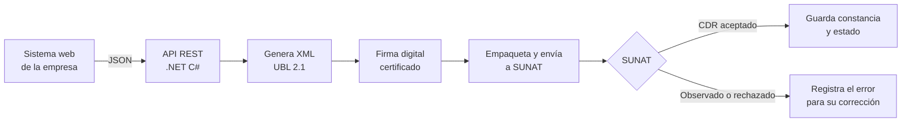

# Facturación electrónica SUNAT: mejora de API e incorporación de la Guía de Remisión Transportista

> **Proyecto · Dirección de Proyectos de TI**
> Evolución de una API REST de facturación electrónica de código abierto: corrección de errores, mejoras de estabilidad y un nuevo comprobante, la **Guía de Remisión Electrónica Transportista**.

<!--
  CÓMO USAR ESTE ARCHIVO
  Los comentarios como este NO se ven en GitHub. Sirven de guía para completar el caso.
  Reemplaza o amplía los textos donde veas "COMPLETAR". Si no tienes una cifra exacta, no la inventes:
  usa un rango aproximado o describe el resultado en palabras.
-->

---

## 📋 Resumen

| | |
|---|---|
| **Rol** | Líder de proyecto y desarrollador |
| **Periodo** | Enero 2026 |
| **Metodología** | SCRUM |
| **Tecnologías** | .NET C#, ASP.NET Web API, XML UBL 2.1, firma digital, servicios web de SUNAT |
| **Punto de partida** | [OpenInvoicePeru](https://github.com/erickorlando/openinvoiceperu), API de código abierto (licencia Apache 2.0) |
| **Entregable principal** | API estabilizada y nuevo módulo de Guía de Remisión Transportista |

<!-- COMPLETAR: si quieres, agrega una fila "Equipo" (por ejemplo: "2 desarrolladores + 1 analista") -->

---

## 🎯 Contexto y problema

La empresa necesitaba emitir comprobantes electrónicos válidos ante SUNAT desde su sistema web, incluyendo la guía que acompaña el traslado de mercadería cuando el transporte lo realiza un tercero.

Se tomó como base **OpenInvoicePeru**, una API REST en C# que genera, firma y envía a SUNAT facturas, boletas, notas de crédito y débito, resúmenes diarios, comunicaciones de baja, retenciones, percepciones y guías de remisión. El proyecto había sido archivado por su autor en 2024, por lo que ya no recibía correcciones.

Esto planteaba tres problemas:

1. **Errores sin resolver** en la generación y el envío de comprobantes.
2. **Falta de la Guía de Remisión Transportista**, necesaria para la operación logística.
3. **Ausencia de mantenimiento**: cualquier cambio de SUNAT tenía que resolverse internamente.

<!-- COMPLETAR: ¿qué impacto tenían esos problemas? Ejemplos: "comprobantes rechazados que se reenviaban a mano",
     "guías emitidas fuera del sistema", "horas de soporte por semana". -->

---

## 🧭 Objetivo

Contar con una API de facturación electrónica **estable, mantenible y completa** para la operación, que emita también la **Guía de Remisión Electrónica Transportista** y se integre con el sistema web de la empresa.

**Criterios de éxito:**
- Comprobantes aceptados por SUNAT en el entorno de pruebas (Beta) y en producción.
- Guía Transportista emitida desde el sistema, con su constancia de recepción (CDR).
- Corrección de los errores identificados sin afectar los comprobantes que ya funcionaban.

---

## 📦 Alcance

| Incluido | Fuera de alcance |
|---|---|
| Diagnóstico y corrección de errores de la API | Cambios en el sistema contable |
| Mejoras de estabilidad y manejo de respuestas de SUNAT | Nuevos tipos de comprobante distintos a la guía |
| Nuevo módulo: Guía de Remisión Transportista | Rediseño de la interfaz de usuario |
| Pruebas en entorno Beta de SUNAT y paso a producción | |
| Documentación técnica y capacitación a usuarios | |

---

## 👤 Mi rol

- **Planificación:** definí el alcance, el backlog y la priorización de errores y mejoras.
- **Análisis:** revisé la normativa y los formatos de SUNAT para la Guía Transportista.
- **Desarrollo:** implementé las correcciones y el nuevo módulo en .NET C#.
- **Calidad:** diseñé y ejecuté las pruebas en el entorno Beta de SUNAT.
- **Puesta en producción:** coordiné el despliegue, la capacitación y el soporte inicial.

---

## 🔄 Gestión del proyecto

El trabajo se organizó con **SCRUM** en sprints cortos, priorizando primero la estabilidad y luego la nueva funcionalidad.

| Fase | Actividades | Resultado |
|---|---|---|
| **1. Diagnóstico** | Revisión del código, registro de errores y priorización por impacto | Backlog priorizado |
| **2. Estabilización** | Corrección de errores y mejoras en el manejo de respuestas | API estable con los comprobantes existentes |
| **3. Guía Transportista** | Análisis de la normativa, modelo de datos, generación del XML, firma y envío | Nuevo comprobante operativo en Beta |
| **4. Pruebas y salida** | Pruebas integrales, paso a producción y capacitación | Solución en producción |

<!-- COMPLETAR: número de sprints y su duración (por ejemplo: "4 sprints de 1 semana"). -->

---

## 🏗️ Solución técnica

### Mejoras y correcciones

- Corrección de errores en la generación y el envío de comprobantes.
- Mejoras de estabilidad en el procesamiento de las respuestas de SUNAT.

<!-- COMPLETAR con 3 a 6 puntos concretos. Ejemplos del tipo de detalle que convence a un reclutador:
     - "Corregí el redondeo de montos en ítems con IGV que causaba rechazos."
     - "Mejoré el manejo de errores al leer el CDR, evitando comprobantes sin estado."
     - "Agregué registro (logs) de cada envío para facilitar el soporte."
     - "Actualicé validaciones según los cambios normativos de SUNAT." -->

### Nuevo módulo: Guía de Remisión Transportista

Se incorporó la emisión de la **Guía de Remisión Electrónica Transportista**, el comprobante que emite la empresa de transporte para sustentar el traslado de bienes de terceros. El módulo cubre:

- El modelo de datos de la guía: transportista, remitente, destinatario, vehículo, conductor, puntos de partida y llegada, y bienes trasladados.
- La generación del XML en el formato exigido por SUNAT.
- La firma digital, el envío y la lectura de la respuesta.

<!-- COMPLETAR: si integraste la guía con el nuevo servicio de SUNAT para guías (API con token),
     menciónalo aquí: es un detalle técnico valioso. -->

---

## ⚠️ Riesgos y cómo se gestionaron

| Riesgo | Mitigación |
|---|---|
| Proyecto base archivado y sin soporte del autor | Revisión completa del código y documentación interna de los cambios |
| Cambios normativos de SUNAT | Validación contra la documentación oficial y pruebas en el entorno Beta |
| Afectar comprobantes que ya funcionaban | Pruebas de regresión antes de cada paso a producción |
| Rechazos en producción | Registro de errores y procedimiento de corrección y reenvío |

---

## 📈 Resultados

- API de facturación electrónica estabilizada y en producción.
- Guía de Remisión Transportista emitida desde el sistema de la empresa.
- Menor dependencia de procesos manuales para la emisión de guías.

<!-- COMPLETAR con cifras si las tienes. Son lo que más pesa en un caso de estudio. Ejemplos:
     - "X errores corregidos"
     - "Rechazos de SUNAT reducidos de X% a Y%"
     - "X guías emitidas en el primer mes"
     - "Tiempo de emisión reducido de X a Y minutos" -->

---

## 💡 Lecciones aprendidas

- **Partir de código abierto acelera, pero exige entenderlo a fondo** antes de modificarlo.
- **Estabilizar primero y luego crecer** evitó sumar funcionalidades sobre una base con errores.
- **El entorno Beta de SUNAT es clave** para validar cada cambio sin riesgo para la operación.

---

## 🙏 Créditos y licencia

Este trabajo se basa en **[OpenInvoicePeru](https://github.com/erickorlando/openinvoiceperu)**, de Erick Orlando, distribuido bajo la licencia **Apache 2.0**. Las mejoras, correcciones y el módulo de Guía de Remisión Transportista descritos aquí son aportes propios.

Los datos de clientes y de la empresa se omiten por confidencialidad.

---

📂 Más proyectos en mi portafolio: **[Dirección de Proyectos](https://enzotarazona.github.io/direccion-proyectos/)** · **[Inicio](https://enzotarazona.github.io)**
